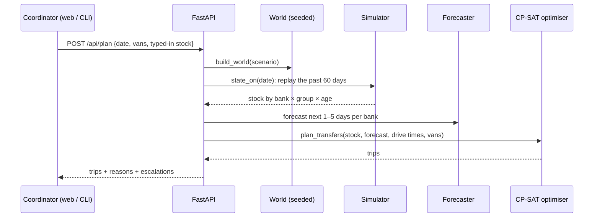

# Architecture

## Components

| Layer | Path | Responsibility |
|---|---|---|
| Real-data fetch | `data/fetch_real_data.py` | Pull blood banks (Overpass/OSM), road matrix (OSRM), weather (Open-Meteo) into `data/raw/` |
| World | `raktsetu/world.py` | Merge real network + bank profiles; build the dengue signal from weather; generate seeded requests and donations; apply scenario events |
| Forecaster | `raktsetu/forecast.py` | Per bank × product (red cells, platelets), 1–5 days ahead. `HistGradientBoostingRegressor` (Poisson loss). Baselines: 7-day mean, same weekday last week, oracle |
| Surge radar | `raktsetu/surge.py` | City-wide platelets, weeks 1–4 ahead, from lagged rain and temperature. Baselines: persistence, same week last year |
| Optimiser | `raktsetu/optimizer.py` | Daily transfer plan (CP-SAT integer programme) |
| Simulator | `raktsetu/simulator.py` | Day-by-day inventory by bank × blood group × age: transfers → issuing (FEFO + compatibility) → phone-around → donations → ageing/expiry |
| Explanations | `raktsetu/explain.py` | Trip cards with reasons, per-bank status, unresolved shortfalls → donor escalation |
| Engine | `raktsetu/engine.py` | Entry points shared by the CLI and the API |
| Evaluation | `raktsetu/evaluate.py` | Forecast metrics, multi-seed policy comparison, sensitivity, reproducibility → `docs/EVALUATION.md` |
| CLI | `raktsetu/__main__.py` | `plan`, `radar`, `simulate`, `train`, `evaluate`, `generate`, `fetch` |
| API | `api/main.py` | FastAPI: `/api/meta`, `/api/plan`, `/api/radar`, `/api/simulate`, `/api/forecast`, `/api/drivers`, `/api/evaluation`; serves `web/dist` |
| Web | `web/` | React 19 + Vite + Tailwind 4 + framer-motion + react-leaflet + Recharts |

## The daily optimisation model

For each morning, banks *b*, products *s* (8 red-cell groups + platelets):

- Forecast mean daily requests μb,s,h for days *h* = 0…Hs−1 (H = 5 for red cells, 3 for platelets).
- **Protected need:** Tb,s = Σμ + zq·√Σ(μ + μ²/ks), the q-quantile (default 0.8) under a negative-binomial error, with *k* fitted on forecast residuals from the validation year.
- **Need** Nb,s = max(0, ⌈T − stock⌉). **At risk** Rb,s = units that would expire unused within 7 days (3 for platelets) if demand ran at the median forecast, oldest-first.
- **Can give** Gb,s = max(stock − T, R) if the bank has no need for *s*, else 0.

Decision variables: xi,j,s ∈ ℤ≥0 (units of *s* from *i* to *j*), yi,j ∈ {0,1} (a van trip *i→j*), ri,s ∈ ℤ≥0 (units saved from expiry).

maximise Σ ws·xi,j,s + wexp·Σ ri,s − Σ (c0 + c1·minutesi,j)·yi,j

subject to
- Σj xi,j,s ≤ Gi,s (never strip a bank below its own protected need)
- Σi xi,j,s ≤ Nj,s (never over-supply)
- Σs xi,j,s ≤ 50·yi,j and xi,j,s ≤ ubi,j,s·yi,j (one cooler box per trip; strong linking)
- Σ yi,j ≤ vans × 4 (trips available)
- ri,s ≤ Ri,s, ri,s ≤ Σj xi,j,s
- arcs only from the 5 nearest banks with spare stock, within 60 minutes

Weights: platelets 3, Rh-negative red cells 2, Rh-positive 1, expiry saved 1; trip cost 1.5 + 0.08/min (in "units of unmet demand").
Executed transfers send the **oldest** units first, so near-expiry stock goes where it will be used.

**Solver.** CP-SAT, 8 parallel workers, 2% relative gap, 1 s limit: about 0.1 s per day on a laptop.
Single-thread deterministic mode took 0.3–1.8 s per day with up to 20% worse plans on hard days. SCIP and CBC took 0.2–1.2 s.
Trade-off: parallel search is not bit-for-bit reproducible (<1% run-to-run difference, measured in `docs/EVALUATION.md`).

## The simulator

State: `inv[bank, sku, age]` (age in days since collection, 0–35).

Each day:
1. **Plan** (RaktSetu only): forecast → optimise → move units (oldest first).
2. **Issue:** serve requests oldest-first; for red cells, substitute compatible groups when the exact group is out (exact first, O− last).
3. **Phone-around** (today's practice, and RaktSetu's emergency fallback): a bank with unmet requests calls its 3 nearest banks within 60 minutes; each lends only stock above 3 days of its own recent use.
4. **Donations:** add today's collections at age 0 (walk-ins, camps, replacement donors; platelets by each bank's separation yield).
5. **Age and expire:** age += 1; red cells ≥35 days and platelets ≥5 days are discarded.

Policies: `isolated` (1, 2, 4, 5), `reactive` (2–5), `raktsetu` (1–5).
Warm-up: 42 days before the evaluation window, excluded from metrics.
Invariant tests: served + unmet = demand; no negative stock; transfers never create units (`tests/test_simulator.py`).

## Forecasting features

Per bank × product × horizon: bank id, product, horizon, target day of week and day of year; requests yesterday, 7-, 28-, 91-day means, previous week's mean, trend (7/28); city-wide 7/28-day means and trend; rain sums over days 0–14, 14–28, 28–56, 56–84 before the forecast; mean temperature over the last 14 days and over days 28–56 before; humidity over the last 14 days.
Red-cell forecasts are made for the bank total and split by the bank's blood-group mix over the past year (shrunk toward the national mix).

## Deployment

One container: a multi-stage `Dockerfile` builds the React app, then FastAPI serves both `/api/*` and the static files on port 8000.
It runs anywhere that runs Docker (Render, Railway, Hugging Face Spaces (Docker), Fly.io). There are no secrets or API keys.

## Extending

- **Real data:** replace `data/bank_profiles.csv` and feed real stock into `engine.todays_plan(..., overrides=...)` (the API accepts the same `overrides`).
- **Another city:** change `BBOX` in `data/fetch_real_data.py`, write a `bank_profiles.csv`, then run `fetch` and `train`.
- **Other perishables:** medicines in public health facilities follow the same structure (stock by expiry date, lateral transfers, a limited vehicle pool).
