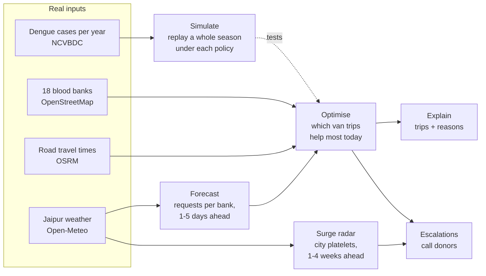

# RaktSetu: project explainer

*What the project does, why it matters, and what it is trying to achieve.*
Abhishek Jadli · COMMIT FOR GOOD 2026 · 12 October 2026 · [Code (MIT)](https://github.com/AbhishekJadli007/raktsetu) · [Live app](https://abhishekjadli007-raktsetu.hf.space)

---

## 1. RaktSetu in one paragraph

RaktSetu tells Jaipur's district blood-transfusion coordinator, every morning, which blood units to move between the city's 18 blood banks, so fewer patients are turned away and fewer units expire on a shelf. In a simulation of the 2024 dengue season, it cut unmet requests by **36%** and expired units by **52%** compared with how banks share today: phoning each other after they run out. It also warns **2–4 weeks ahead** when the whole city will be short of platelets, so donor drives can start in time.

The name means "a bridge for blood" (*rakt* = blood, *setu* = bridge). It is open source (MIT) and was built for COMMIT FOR GOOD 2026, whose theme is AI for resilient and sustainable supply chains.

## 2. The problem

> **Blood-bank coordinators in Jaipur cannot move stock to where it will be needed before it runs out or expires, because each bank plans alone and e-RaktKosh only shows today's stock, which causes platelet shortages in dengue season while units are discarded unused a few kilometres away.**

India now collects roughly as much blood as it needs, so the failure is in **distribution, not supply**. That is the same pattern as India's 2021 medical oxygen crisis: the goods existed, but the information and decisions needed to move them did not.

| What | Number | Source |
|---|---|---|
| Units collected in India, 2024–25 | 14.6 million, about the national requirement | [ORF, Oct 2025](https://www.orfonline.org/expert-speak/securing-india-s-lifeblood-for-a-reliable-national-blood-supply) |
| Share of collected units wasted | 5–15% (expiry, breakage, poor component management) | [ORF, Oct 2025](https://www.orfonline.org/expert-speak/securing-india-s-lifeblood-for-a-reliable-national-blood-supply) |
| Units discarded by Indian blood banks, 2012–2016 | About 28 lakh | NACO data via RTI ([Business Insider, 2017](https://www.businessinsider.in/india-lost-6-lakh-litres-of-blood-in-five-years/articleshow/58338754.cms)) |
| Median blood stock in 8 states incl. Rajasthan | 0.6 units per 1,000 people; 22% of banks rarely update e-RaktKosh | [BMJ Global Health, Oct 2024](https://doaj.org/article/99ff305cac114d16a01b74de21e909c0) |
| Rajasthan dengue cases | 20,749 in 2021; 12,514 in 2024 | [NCVBDC](https://ncvbdc.mohfw.gov.in/Doc/Dengue-Cases-deaths-2021-2026-till-April.pdf) |
| Platelet requests at one Jaipur bank, October dengue surge | 15–20 a month rose to 50–60 a day | [LivLong Health Story](https://healthstory.livlong.com/news/increase-in-dengue-cases-leads-to-rising-demand-for-platelets) |
| Shelf life | Platelets 5 days; red cells 35 days | Standard storage limits |

**Who is hurt:**
- **Patients** who need red cells (surgery, accidents, childbirth, thalassaemia) or platelets (dengue, chemotherapy).
- **Families**, who are sent from bank to bank to find a unit.
- **Blood-bank officers**, who discover a shortage only when a request arrives.
- **Donors**, whose blood is thrown away unused.

## 3. Why today's tools fall short

Today's tools show stock or react to shortages. None of them tells anyone what to do before a shortage happens.

| Today | What it does | What it misses |
|---|---|---|
| **e-RaktKosh** (national blood-bank portal) | Shows current stock at registered banks | No forecast, no recommended transfers, no surge warning; 22% of banks rarely update it |
| **Phone-around** (how banks share now) | A bank that runs out calls nearby banks for spare units | Starts after a patient is already waiting; nobody moves units that are about to expire |
| **Each bank plans alone** | Collects and stores for its own patients | Camp-running NGO banks over-collect while large hospital banks run short, a few kilometres apart |

The gap is the step between *seeing* stock and *deciding* what to do with it. RaktSetu is built for that step.

## 4. What RaktSetu does

Give it a date. It returns the van trips to make that morning, the shortfalls that need donors instead of vans, and a 4-week platelet warning for the city.

**Input:** a date. Optionally: real stock typed in for any bank, the number of vans available, or a crisis to test (a broken platelet machine, an accident, a severe dengue year).

**Output:**
1. **Today's transfers.** Which bank sends which blood groups to which bank, how many units, and the reasons for each trip.
2. **Escalations.** Shortfalls that no bank can cover without risking its own patients, flagged for donor drives or apheresis.
3. **Surge radar.** Expected city-wide platelet need for each of the next 4 weeks, compared with current production, with an alert level.

**The user** is the district blood-transfusion coordinator (or the State Blood Transfusion Council), plus each blood bank's officer in charge.

**A coordinator's morning with RaktSetu:**
1. Opens the Control Room. The map shows all 18 banks, each coloured by how many days its stock will last.
2. Reviews the recommended trips. *Example:* Pushpa Devi blood bank sends 18 B+ and 17 O+ red cells to SMS, because SMS expects about 66 B+ requests in 5 days and Pushpa's units would otherwise expire within a week.
3. Checks the escalations. *Example:* the cancer hospital (BMCHRC) needs 38 more platelets than any bank can spare, so donors are called.
4. Checks the surge radar. *Example:* on 20 August 2024 it forecast about 118 platelets a day needed by the week of 10 September, against 74 a day produced: three weeks before the peak.
5. If a bank reports different stock, types the real numbers in and gets a new city-wide plan in seconds.

## 5. How it works



1. **Forecast (machine learning).** A gradient-boosted model predicts each bank's red-cell and platelet requests for the next 1–5 days. It learns from recent requests and from rainfall in the previous weeks, because rain leads dengue by about 8 weeks. *Why this method:* it beats the simple rule banks use today (last 7 days' average), though only modestly (section 7).
2. **Optimise (operations research).** Each morning an integer programme (Google OR-Tools CP-SAT) chooses the van trips that prevent the most shortages and expiries, within the vans and cooler boxes available. It never takes a bank below its own protected need, and it sends the oldest units first so near-expiry blood goes where it will be used. *Why:* "what should move today, given limited vans" is an allocation problem; it needs no training data and is solved exactly in about 0.1 seconds.
3. **Explain.** Every trip lists its reasons in plain words, for example "SMS expects ~66 B+ requests in 5 days; Pushpa's B+ units would expire within a week". Shortfalls that no bank can spare are escalated to donors instead of being hidden.
4. **Surge radar.** A city-level model forecasts platelet need 1–4 weeks ahead from lagged rainfall and temperature. *Why:* at the dengue peak the whole city is short of platelets, and no reallocation can fix that. The useful action is to book donors early, which needs weeks of warning.
5. **Simulate.** A day-by-day model of all 18 banks, tracking every blood group and the age of every unit. It replays a full season under three policies (banks alone, today's phone-around, RaktSetu) with the same requests and donations, so the only difference is how banks coordinate.

## 6. Data: what is real and what is simulated

| Input | Real or simulated | Source |
|---|---|---|
| 18 blood-bank names and locations | **Real** | OpenStreetMap |
| Road travel times between every pair of banks (324 pairs) | **Real** | OSRM on OpenStreetMap roads |
| Daily Jaipur rain, temperature, humidity, 2016–2026 | **Real** | Open-Meteo (ERA5) |
| Rajasthan dengue cases per year | **Real** (2018–20 and 2026 imputed, and flagged) | NCVBDC; Rajya Sabha answer |
| Blood-group mix | **Real** | National study of 10,000 donors (Agrawal et al., 2014) |
| Daily requests and donations per bank | **Simulated** (fixed seed, reproducible) | Generated from published totals |
| Each bank's size and role | **Assumed** | Inferred from the hospital type |

**Why simulation is acceptable here.** Daily stock and request data for each bank is not public in India. The hackathon allows documented synthetic data. Every parameter, its value and its source or reason is listed in [`data/ASSUMPTIONS.md`](../data/ASSUMPTIONS.md); the generator is in the repository with a fixed seed; and a sensitivity analysis varies the guesses that matter most.

**The honest claim:** *on a simulated Jaipur network built on real structure, RaktSetu reduced unmet requests and expired units compared with phone-around sharing, which suggests it is worth piloting with real stock data.* It is not a measured real-world result.

## 7. Results

Measured over 5 random seeds (each regenerates every request and donation), against today's phone-around practice. Full tables: [`docs/EVALUATION.md`](EVALUATION.md).

**2024 dengue season (15 Aug–30 Nov), mean of 5 seeds:**

| Policy | Requests not met | Units expired | Red-cell fill rate | Platelet fill rate | Van-km |
|---|---|---|---|---|---|
| Banks working alone | 4,218 | 4,718 | 94.0% | 77.3% | 0 |
| Phone-around (today) | 2,602 | 3,203 | 96.9% | 84.9% | 2,372 |
| RaktSetu, simple 7-day forecast | 1,688 | 1,525 | 99.8% | 87.2% | 4,853 |
| **RaktSetu, ML forecast** | **1,664** | **1,538** | **99.8%** | **87.4%** | 5,022 |
| RaktSetu, perfect forecast (upper bound) | 1,507 | 1,410 | 99.8% | 88.6% | 4,941 |

**What the numbers say:**
- **Versus phone-around: 36% fewer unmet requests and 52% fewer expired units** in the 2024 dengue season, and **80% fewer unmet and 43% fewer expired** across 2025.
- **The improvement holds under every assumption we varied.** Size of the dengue peak, collection versus demand, 1–3 vans, and service level all give −12% to −84% unmet and −23% to −86% expired.
- **Most of the gain comes from coordination, not from the ML.** The simple-forecast version already captures most of it. **One van is enough** for Jaipur, because all banks are 6–25 minutes apart.
- **The forecast beats its baseline, modestly.** Error (WAPE) is 33.2% vs 35.8% for red cells and 52.8% vs 55.6% for platelets. The noise floor is 33.1% and 51.5%: daily counts at one bank are so noisy that even a perfect model has about that much error.
- **The surge radar earns its place 3–4 weeks ahead:** error 13.6–14.6% vs 20.5–24.8% for "current level persists". For next week the simple rule is as good, and we say so.
- **The cost:** roughly double the van-kilometres of phone-around.

## 8. What we are trying to achieve

| When | Goal | How we will know |
|---|---|---|
| **Now (hackathon)** | Show a working, honest, open-source method that anyone can run on any date or crisis | Live app, command-line tool, 15 automated tests, evaluation against baselines |
| **Next (pilot)** | One district, 8 weeks of dengue season: read-only stock export from e-RaktKosh, plan reviewed each morning by the District Blood Transfusion Officer | Discarded units and turned-away requests, compared with the previous season |
| **Later** | A state-level coordination layer on top of e-RaktKosh, plus the same engine for medicines in public health facilities (a CAG audit in UP found stock-outs of up to 1,433 days alongside ₹27.06 crore of expired drugs) | Fewer discarded units; fewer patients sent from bank to bank |

The bigger aim is the one the hackathon theme names: a supply chain that is **resilient** (patients get blood during a dengue surge or a crisis) and **sustainable** (donated blood is not wasted). In blood supply these two pull in opposite directions, because holding more stock prevents shortages but causes expiry. RaktSetu improves both at once by moving stock to where it will be used.

## 9. Limitations and open questions

- **Demand is simulated.** Bank profiles are guesses. A pilot needs real stock data.
- **The dengue signal is modelled** from real rainfall and real yearly case counts using published lags. It is not fitted to weekly district case data.
- **Clinical and legal rules are simplified.** Platelets are pooled across blood groups, and the rules for transfers between banks (licensing, cross-matching, cold chain) must be confirmed with the Rajasthan State Blood Transfusion Council.
- **"Unmet request" is an indicator, not a count of harmed patients.** In reality patients wait, are referred, or families donate.
- **More driving:** about 2,650 extra van-km per dengue season.
- **The main open question: why would government, NGO and private banks share stock?** The plan never takes a bank below its own protected need, and in dengue season every bank is sometimes on the receiving end. Adoption still needs a state-level mandate or incentive, which is a policy question, not a software one.

## 10. See it yourself

- **Live app:** https://abhishekjadli007-raktsetu.hf.space (it may take about a minute to wake up). The four views are:
  - **Overview:** the problem and the result.
  - **Control Room:** today's plan, a map, and stock you can edit.
  - **Simulation Lab:** crises and a day-by-day replay.
  - **Evidence & Method:** all the numbers and limits.
- **Code and documents:** https://github.com/AbhishekJadli007/raktsetu (MIT licence)
- **On your own computer** (Python 3.11):

```bash
git clone https://github.com/AbhishekJadli007/raktsetu.git && cd raktsetu
python3.11 -m venv .venv && source .venv/bin/activate && pip install -r requirements.txt
python -m raktsetu plan --date 2026-10-10        # this morning's transfers, with reasons
python -m raktsetu radar --date 2024-08-20       # platelet surge warning
python -m raktsetu simulate --start 2024-08-15 --end 2024-11-30   # compare the three policies
```

## 11. Glossary

| Term | Meaning |
|---|---|
| Platelets | The blood component that stops bleeding. Dengue destroys platelets, so dengue patients need them. Shelf life 5 days. |
| Red cells (PRBC) | The component that carries oxygen; used in surgery, trauma, childbirth and thalassaemia. Shelf life 35 days. |
| Unmet request | A request a bank could not fill from its own stock, a substitute group, or a neighbour. |
| Expired unit | A unit discarded because it passed its shelf life unused. |
| Oldest-first (FEFO) | "First expiry, first out": issue the unit closest to expiry first. |
| ABO/Rh compatibility | Which blood groups can safely receive which; RaktSetu substitutes compatible red cells when the exact group is out. |
| Apheresis | Collecting platelets directly from a donor with a machine. |
| Replacement donor | A patient's relative who donates in return for a unit (about 30% of India's supply). |
| e-RaktKosh | India's national blood-bank information portal. |
| Phone-around | Today's practice: a bank that runs out calls nearby banks. |
| Baseline | The simple method a model must beat to prove it adds value (here, last 7 days' average). |
| WAPE | Weighted absolute percentage error, a forecast-error measure; lower is better. |
| Noise floor | The error even a perfect forecast would have, because daily counts vary randomly. |
| CP-SAT / integer programme | A mathematical optimisation method (Google OR-Tools) that finds the best whole-number plan under limits. |
| Simulation seed | A number that fixes the random draws, so every result can be reproduced exactly. |
| Sensitivity analysis | Re-running the evaluation with different assumptions to check the conclusion still holds. |
| Days of cover | How many days a bank's stock would last at its expected demand. |
